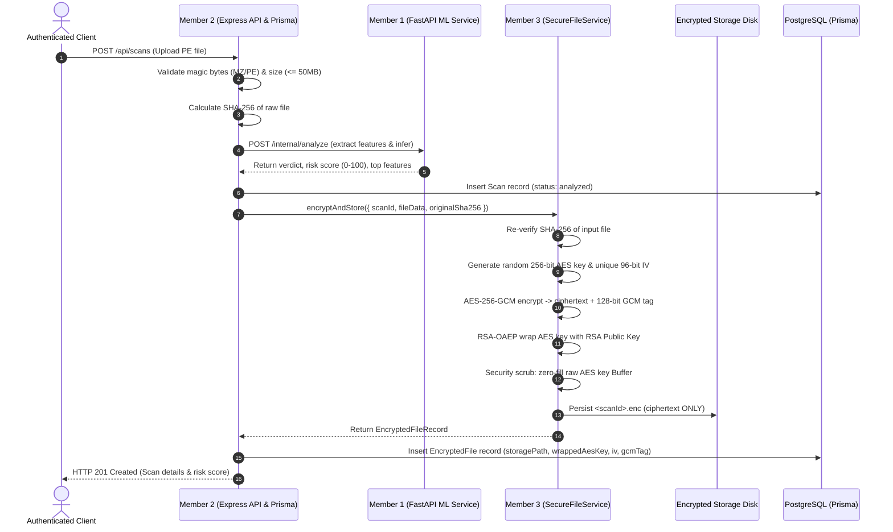
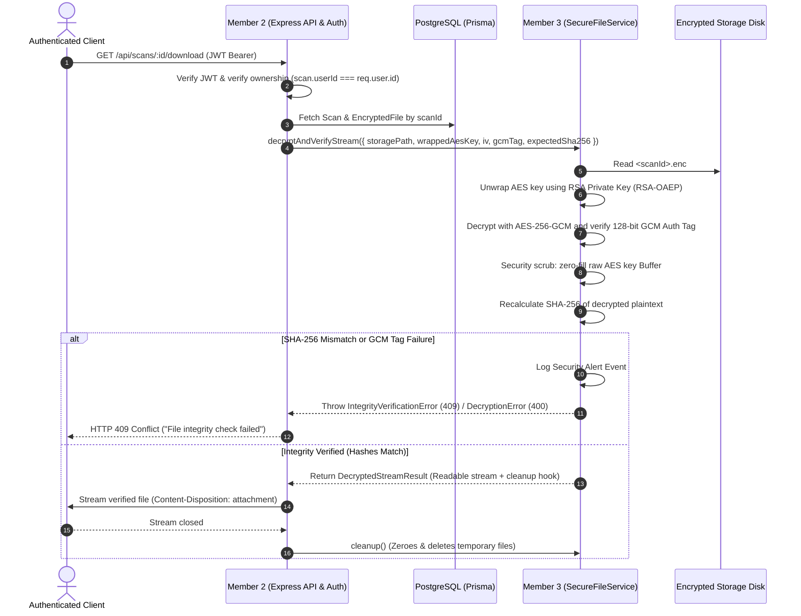

# CipherGuard AI - Cryptography & Secure Storage Architecture

**Module Owner:** Member 3 (Cryptography & Secure Storage)  
**Target Consumers:** Member 2 (Backend, Database & Authentication), DevOps  
**Version:** 1.0 (Phase 2 Delivery)

---

## 1. Executive Summary & Principles

CipherGuard AI operates as an AI-powered static malware threat assessment engine and **zero-trust file vault**. Cryptographic operations adhere to three core pillars:

1. **AES-256-GCM** provides symmetric confidentiality and authenticated encryption with a unique 256-bit key and unique 96-bit IV per file.
2. **RSA-OAEP** protects the ephemeral AES key via envelope encryption using an asymmetric 4096-bit (or 2048-bit min) RSA key pair. The RSA private key remains strictly outside the application database and source control.
3. **SHA-256** provides end-to-end integrity verification, calculated immediately upon raw file upload and recalculated post-decryption before any file is returned.

---

## 2. Core Cryptographic Workflows

### 2.1 Encryption & Ingestion Flow (After Successful ML Analysis)

> **CRITICAL RULE (BR-2):** A file MUST only be encrypted and stored AFTER the static analysis has been successfully recorded in PostgreSQL. Unanalyzed files are never stored.



### 2.2 Decryption & Download Flow (With Integrity Re-verification)



---

## 3. Cryptographic Primitives & Specifications

| Parameter | Specification | Standard / RFC | Security Rationale |
| :--- | :--- | :--- | :--- |
| **Symmetric Encryption** | AES-256-GCM | NIST SP 800-38D | Authenticated encryption providing confidentiality and integrity |
| **AES Key Size** | 256 bits (32 bytes) | FIPS 197 | Quantum-resistant symmetric security margin |
| **Initialization Vector (IV)** | 96 bits (12 bytes) | NIST SP 800-38D §5.2.1.1 | Deterministic 12-byte nonce avoiding hash sub-layer; unique per file |
| **GCM Authentication Tag** | 128 bits (16 bytes) | NIST SP 800-38D §5.2.1.2 | Maximum cryptographic authentication strength |
| **Key Wrapping** | RSA-OAEP | RFC 8017 (PKCS#1 v2.2) | Protects per-file symmetric key against storage compromise |
| **RSA Modulus Length** | 4096-bit (2048-bit min) | NIST SP 800-57 | Long-term asymmetric protection |
| **OAEP Hash Function** | SHA-256 | RFC 8017 | Modern collision-resistant hash |
| **Integrity Hashing** | SHA-256 | FIPS 180-4 | Cryptographic hash verified at upload and download |
| **Hash Comparison** | Constant-Time Comparison | `crypto.timingSafeEqual` | Eliminates timing-attack vectors |

---

## 4. Metadata Schema & PostgreSQL Mapping

Database schema implemented in `backend/prisma/schema.prisma`:

```prisma
model EncryptedFile {
  id             String    @id @default(uuid())
  scanId         String    @unique @map("scan_id")
  storagePath    String    @map("storage_path")
  wrappedAesKey  Bytes     @map("wrapped_aes_key")
  iv             Bytes     @map("iv")
  gcmTag         Bytes     @map("gcm_tag")
  encryptedAt    DateTime  @default(now()) @map("encrypted_at")
  scan           Scan      @relation(fields: [scanId], references: [id], onDelete: Cascade)

  @@map("encrypted_files")
}
```

### Type Mapping for Node.js / TypeScript:
- `wrappedAesKey`: `Buffer` (RSA ciphertext: 256 or 512 bytes)
- `iv`: `Buffer` (12 bytes)
- `gcmTag`: `Buffer` (16 bytes)
- `storagePath`: `string` (e.g. `"<scanId>.enc"`)

---

## 5. Storage Directory Layout

```
backend/storage/
├── encrypted/              # ONLY ciphertext blobs (<scanId>.enc)
│   ├── .gitkeep
│   └── 3f8a49c2-...enc     # Mode 0600, restricted to backend user
└── temp/                   # Transient plaintext (for streaming downloads)
    ├── .gitkeep
    └── cg_dl_...dec        # Automatically scrubbed & zero-wiped upon stream end
```

**Security Guarantees:**
- No `.exe`, `.dll`, or other plaintext files are ever persisted in `storage/encrypted/`.
- Paths are strictly validated against directory traversal (`..`, null bytes, slashes).
- The storage directory is never exposed to Express static file serving.

---

## 6. Integration Guide for Member 2

### 6.1 Installation / Import
Member 2 can import the service directly:

```typescript
import {
  SecureFileService,
  IntegrityVerificationError,
  DecryptionError,
  KeyUnwrapError
} from '../services/secure-file.service.js';

// Initialize singleton
const secureFileService = new SecureFileService();
```

### 6.2 Upload Controller Integration (After ML Analysis)

```typescript
// Inside POST /api/scans handler (Member 2):
// 1. User uploaded file, validated as PE, SHA-256 computed
// 2. ML service returned verdict and riskScore
// 3. Scan saved to database

const scan = await prisma.scan.create({
  data: {
    userId: req.user.id,
    originalFilename: req.file.originalname,
    sha256Hash: uploadSha256,
    verdict: mlResult.verdict,
    riskScore: mlResult.riskScore,
    explanation: mlResult.topFeatures,
    modelVersion: 'ember-2018-rf-v1.0',
  },
});

// 4. Encrypt and persist with Member 3 module:
const cryptoRecord = await secureFileService.encryptAndStore({
  scanId: scan.id,
  fileData: req.file.buffer, // or path to temp upload
  originalSha256: uploadSha256,
});

// 5. Persist crypto metadata to PostgreSQL:
await prisma.encryptedFile.create({
  data: {
    id: cryptoRecord.id,
    scanId: scan.id,
    storagePath: cryptoRecord.storagePath,
    wrappedAesKey: cryptoRecord.wrappedAesKey,
    iv: cryptoRecord.iv,
    gcmTag: cryptoRecord.gcmTag,
    encryptedAt: cryptoRecord.encryptedAt,
  },
});
```

### 6.3 Download Controller Integration (With Error Handling)

```typescript
// Inside GET /api/scans/:id/download handler (Member 2):
const scan = await prisma.scan.findUnique({
  where: { id: req.params.id },
  include: { encryptedFile: true },
});

if (!scan || scan.userId !== req.user.id) {
  return res.status(403).json({ error: 'Access denied.' });
}

if (!scan.encryptedFile) {
  return res.status(404).json({ error: 'Encrypted file not found.' });
}

try {
  const result = await secureFileService.decryptAndVerifyStream({
    storagePath: scan.encryptedFile.storagePath,
    wrappedAesKey: scan.encryptedFile.wrappedAesKey,
    iv: scan.encryptedFile.iv,
    gcmTag: scan.encryptedFile.gcmTag,
    expectedSha256: scan.sha256Hash,
  });

  res.setHeader('Content-Type', 'application/octet-stream');
  res.setHeader('Content-Disposition', `attachment; filename="${scan.originalFilename}"`);
  res.setHeader('Content-Length', result.contentLength);

  result.stream.pipe(res);
} catch (err) {
  if (err instanceof IntegrityVerificationError) {
    // SRS FR-9.2 requires HTTP 409 and security alert log
    return res.status(409).json({
      error: 'File integrity check failed: file has been tampered with or corrupted.',
      code: 'CIPHERGUARD_INTEGRITY_MISMATCH',
    });
  }
  if (err instanceof DecryptionError || err instanceof KeyUnwrapError) {
    return res.status(400).json({
      error: 'Decryption failed: corrupted data or unauthorized key.',
      code: 'CIPHERGUARD_DECRYPTION_FAILED',
    });
  }
  next(err);
}
```

---

## 7. Key Management & Environment Secrets

### 7.1 Key Generation CLI
To generate a 4096-bit RSA key pair:
```bash
npm run generate-keys
```

### 7.2 Production Environment Variables
| Variable | Description | Production Source |
| :--- | :--- | :--- |
| `CIPHERGUARD_RSA_PUBLIC_KEY` | Public Key PEM string | Config map / env var |
| `CIPHERGUARD_RSA_PRIVATE_KEY` | Private Key PEM string | AWS Secrets Manager / Vault |
| `CIPHERGUARD_STORAGE_ROOT` | Permanent file vault root path | Persistent Docker Volume / EBS |
| `CIPHERGUARD_ALLOW_DEV_KEYS` | In-memory dev key fallback | MUST BE `false` in production |

---

## 8. Testing Instructions

To run the complete test suite (51 tests):
```bash
npm test
```

To run TypeScript verification:
```bash
npm run typecheck
```

To build production JavaScript bundle and declarations:
```bash
npm run build
```
